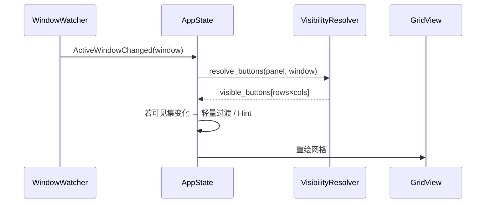

# 按钮应用关联可见性 — 设计与实现计划

> 按前台应用动态显示关联按钮，同时保留「始终显示」按钮  
> 版本：v0.1（设计稿）  
> 更新日期：2026-08-06

---

## 目录

1. [背景与目标](#1-背景与目标)
2. [现状分析](#2-现状分析)
3. [方案对比与选型](#3-方案对比与选型)
4. [核心概念](#4-核心概念)
5. [数据模型](#5-数据模型)
6. [配置文件](#6-配置文件)
7. [运行时逻辑](#7-运行时逻辑)
8. [UI 与交互设计](#8-ui-与交互设计)
9. [与 Profile 系统的关系](#9-与-profile-系统的关系)
10. [迁移与兼容](#10-迁移与兼容)
11. [分阶段实现计划](#11-分阶段实现计划)
12. [测试计划](#12-测试计划)
13. [风险与待定事项](#13-风险与待定事项)

---

## 1. 背景与目标

### 1.1 用户需求

1. **每个按钮**可配置与前台应用的关联；另有一种类型为**不关联、始终显示**。
2. 当某个应用被激活置前时，面板中只显示：
   - 与该应用关联的按钮；
   - 以及标记为「始终显示」的按钮。

### 1.2 产品目标

| 目标 | 说明 |
|------|------|
| 上下文感知 | 同一面板在不同应用下呈现不同快捷操作，减少无关按钮干扰 |
| 操作连贯 | 通用操作（复制、粘贴等）始终可用，不因切换应用消失 |
| 配置简单 | 在现有按钮编辑流程中增加「可见范围」一项，学习成本低 |
| 向后兼容 | 现有 Profile 配置无需改动即可继续工作 |

### 1.3 非目标（首版不做）

- 按窗口标题正则做按钮级精细匹配（可预留字段，首版仅 bundle_id / app_name）
- 同一按钮关联多个互斥应用组
- 云同步、按钮共享市场
- 替换现有窗口轮询为 NSWorkspace 通知（沿用现有 200ms 轮询）

---

## 2. 现状分析

### 2.1 已有能力

MeoTool 已具备完整的**前台应用检测**与**Profile 级切换**：

```
WindowWatcher (200ms 轮询)
    → WindowInfo { app_name, bundle_id, title, process_id, ... }
    → ProfileResolver.resolve(window)
    → switch_profile → 整页替换 panel.buttons
```

| 模块 | 路径 | 作用 |
|------|------|------|
| 窗口轮询 | `src/window/watcher.rs` | 检测前台窗口变化 |
| 匹配规则 | `src/config/resolver.rs` `MatchRule::matches` | bundle_id / title_regex / app_name |
| 状态切换 | `src/app/state.rs` `on_active_window_changed` | Profile 切换 + 过渡动画 |
| 网格渲染 | `src/ui/grid.rs` | `panel.padded_buttons()` 固定 rows×cols |
| 按钮触发 | `src/app/state.rs` `trigger_button(index)` | 按网格索引执行动作 |

### 2.2 与需求的差距

| 现状 | 差距 |
|------|------|
| 关联粒度在 **Profile**（整页按钮集） | 需要 **Button** 级关联 |
| 切换应用 → 替换整个按钮列表 | 需要同一布局内 **过滤显示** |
| 不同 Profile 可有不同 rows/cols | 过滤后可见按钮数变化，需定义布局策略 |
| 数字键/方向键绑定 **固定槽位索引** | 隐藏按钮后索引语义需统一 |

### 2.3 可复用资产

- `WindowInfo` + `MatchRule::matches` — 直接作为按钮可见性判定
- `last_active_window` — 运行时已有前台上下文
- `ProfileTransition` / `HintOverlay` — 可复用于「可见按钮集变化」时的轻量反馈
- 设置界面 / 按钮编辑器的 `MatchRule` 表单 — 可复用为按钮关联编辑

---

## 3. 方案对比与选型

### 3.1 三种架构路线

#### 方案 A：Profile 内按钮过滤（增量式）

- 保留 Profile 切换；在每个 Profile 的按钮上增加 `scope`
- 流程：`resolve Profile` → `filter buttons by scope + window`

**优点**：改动小，完全向后兼容  
**缺点**：按钮仍分散在多个 Profile，配置重复；Profile 与按钮 scope 语义重叠，用户困惑

#### 方案 B：统一按钮池 + 应用过滤（推荐）

- 所有按钮集中在 **default Profile**（或单一 master Profile）
- 取消 Profile 级整页切换，改为按钮级 `scope` 过滤
- Profile 仅保留为「面板样式分组」或逐步废弃

**优点**：符合用户心智——「一个面板，随应用变内容」  
**缺点**：需迁移现有 multi-profile 用户；不同应用不同 rows/cols 的能力弱化

#### 方案 C：双模式（推荐落地方式）

通过全局开关 `context_mode` 支持两种行为：

| 模式 | 值 | 行为 |
|------|-----|------|
| Profile 切换 | `"profile"`（默认） | **现有行为**，不变 |
| 按钮过滤 | `"button_filter"` | 使用 default Profile 的布局 + 全量按钮池过滤 |

首版实现 **方案 C**，默认 `profile` 保证零破坏；用户可在设置中切换到 `button_filter` 启用新能力。长期可将 `button_filter` 设为默认并弱化 Profile 切换。

### 3.2 布局策略选型

过滤后可见按钮数 ≤ rows×cols，需决定空槽如何处理：

| 策略 | 说明 | 键盘索引 | 推荐 |
|------|------|----------|------|
| **固定槽位** | 按钮配置顺序对应固定格子；不可见槽位渲染为空/disabled | 槽位不变，隐藏格不可触发 | ✅ 首版 |
| 紧凑填充 | 可见按钮从左到右、从上到下紧凑排列 | 数字键随应用变化 | 二期可选 |
| 动态网格 | 按可见数重算 rows/cols，窗口尺寸变化 | 复杂 | 不做 |

**首版采用固定槽位**：配置中第 N 个按钮永远在第 N 格；不可见时该格为空白占位（`enabled=false, action=None`），不响应点击与快捷键。这与现有 `padded_buttons` 逻辑一致，改动最小。

---

## 4. 核心概念

### 4.1 按钮可见范围（ButtonScope）

```
ButtonScope
├── Always          # 始终显示（默认，向后兼容）
└── WhenActive(MatchRule)  # 仅当前台窗口匹配规则时显示
```

- `Always`：不关联应用，任何前台应用下均显示。
- `WhenActive`：复用现有 `MatchRule`（bundle_id / app_name / title_regex），与 Profile 匹配逻辑一致。

### 4.2 可见性判定

```rust
fn button_visible(scope: &ButtonScope, window: Option<&WindowInfo>) -> bool {
    match scope {
        ButtonScope::Always => true,
        ButtonScope::WhenActive(rule) => {
            window.is_some_and(|w| rule.matches(w))
        }
    }
}
```

无前台窗口信息时（极少数启动瞬间）：`WhenActive` 按钮隐藏，仅显示 `Always`。

### 4.3 上下文模式（ContextMode）

```rust
enum ContextMode {
    Profile,      // 现有：整 Profile 切换
    ButtonFilter, // 新：单池过滤
}
```

---

## 5. 数据模型

### 5.1 新增类型

```rust
// src/config/model.rs

#[derive(Debug, Clone, PartialEq, Eq, Default)]
pub enum ButtonScope {
    #[default]
    Always,
    WhenActive(MatchRule),
}

// ButtonConfig 扩展
pub struct ButtonConfig {
    // ... 现有字段 ...
    pub scope: ButtonScope,  // 新增，默认 Always
}

// AppConfig 扩展
pub struct AppConfig {
    // ... 现有字段 ...
    pub context_mode: ContextMode,  // 新增，默认 Profile
}
```

### 5.2 运行时视图

```rust
// src/config/model.rs 或 src/config/visibility.rs

pub struct ResolvedPanel {
    pub panel: PanelConfig,           // rows/cols/theme 等
    pub buttons: Vec<ButtonConfig>,     // 长度 = rows×cols，已应用可见性
    pub visible_count: usize,           // 当前可见且 enabled 的按钮数
    pub context_label: String,          // 顶栏提示：应用名或 "通用"
}

impl PanelConfig {
    /// 根据前台窗口解析可见按钮（固定槽位策略）
    pub fn resolve_visibility(
        &self,
        window: Option<&WindowInfo>,
    ) -> Vec<ButtonConfig> {
        let slots = self.slot_count();
        self.buttons
            .iter()
            .take(slots)
            .map(|btn| {
                if btn.scope.is_visible(window) && btn.enabled {
                    btn.clone()
                } else if btn.scope.is_visible(window) {
                    btn.clone() // enabled=false 仍占位但不可点
                } else {
                    empty_slot_button() // 隐藏：空占位
                }
            })
            .chain(std::iter::repeat_with(empty_slot_button))
            .take(slots)
            .collect()
    }
}
```

`AppState.panel.buttons` 在 `button_filter` 模式下存**全量**按钮；渲染与触发时使用 `resolve_visibility(last_active_window)` 的结果。

### 5.3 索引语义

| 概念 | 含义 |
|------|------|
| **配置索引** | 按钮在 `profile.buttons` 中的下标，编辑、保存时使用 |
| **槽位索引** | 网格 0..rows×cols-1，与配置索引一一对应（固定槽位策略） |

固定槽位下两者相同，无需额外映射表。

---

## 6. 配置文件

### 6.1 全局模式

```toml
# 可选，默认 "profile"
context_mode = "button_filter"
```

### 6.2 按钮 scope（TOML）

**始终显示（默认，可省略）**

```toml
[[profiles.buttons]]
label = "复制"
icon = "copy.png"
# scope 省略 = always

[profiles.buttons.action]
type = "hotkey"
keys = ["Cmd", "c"]
```

**关联应用 — 仅 bundle_id**

```toml
[[profiles.buttons]]
label = "格式化"
icon = "format.png"

[profiles.buttons.scope]
type = "when_active"
bundle_id = "com.microsoft.VSCode"

[profiles.buttons.action]
type = "hotkey"
keys = ["Shift", "Option", "f"]
```

**关联应用 — app_name（Chrome / Safari 等）**

```toml
[[profiles.buttons]]
label = "新标签"
icon = "new_tab.png"

[profiles.buttons.scope]
type = "when_active"
app_name = "Google Chrome"

[profiles.buttons.action]
type = "hotkey"
keys = ["Cmd", "t"]
```

**等价简写（可选语法糖，二期）**

```toml
[[profiles.buttons]]
label = "保存"
scope = "always"   # 字符串简写

[[profiles.buttons]]
label = "运行"
scope = { bundle_id = "com.microsoft.VSCode" }  # 简写 when_active
```

### 6.3 完整示例（button_filter 模式）

```toml
context_mode = "button_filter"

[global.panel]
rows = 3
cols = 4

[[profiles]]
name = "default"

# 槽位 1：始终显示
[[profiles.buttons]]
label = "复制"
icon = "copy.png"
[profiles.buttons.action]
type = "hotkey"
keys = ["Cmd", "c"]

# 槽位 2：始终显示
[[profiles.buttons]]
label = "粘贴"
icon = "paste.png"
[profiles.buttons.action]
type = "hotkey"
keys = ["Cmd", "v"]

# 槽位 3：仅 VS Code
[[profiles.buttons]]
label = "格式化"
icon = "format.png"
[profiles.buttons.scope]
type = "when_active"
bundle_id = "com.microsoft.VSCode"
[profiles.buttons.action]
type = "hotkey"
keys = ["Shift", "Option", "f"]

# 槽位 4：仅 VS Code
[[profiles.buttons]]
label = "终端"
icon = "terminal.png"
[profiles.buttons.scope]
type = "when_active"
bundle_id = "com.microsoft.VSCode"
[profiles.buttons.action]
type = "hotkey"
keys = ["Ctrl", "`"]

# 槽位 5：仅 Chrome
[[profiles.buttons]]
label = "新标签"
icon = "new_tab.png"
[profiles.buttons.scope]
type = "when_active"
app_name = "Google Chrome"
[profiles.buttons.action]
type = "hotkey"
keys = ["Cmd", "t"]

# 其余槽位自动补空
```

**前台 VS Code 时显示**：复制、粘贴、格式化、终端（槽位 5 为空）  
**前台 Chrome 时显示**：复制、粘贴、新标签  
**其他应用**：复制、粘贴

### 6.4 TOML 反序列化扩展

```rust
// src/config/toml_model.rs

#[derive(Debug, Default, Deserialize, Serialize)]
#[serde(tag = "type", rename_all = "snake_case")]
pub enum ButtonScopeFile {
    #[default]
    Always,
    WhenActive {
        bundle_id: Option<String>,
        app_name: Option<String>,
        title_regex: Option<String>,
    },
}

pub struct ButtonFile {
    // ... 现有字段 ...
    #[serde(default)]
    pub scope: ButtonScopeFile,
}
```

---

## 7. 运行时逻辑

### 7.1 事件流（button_filter 模式）



### 7.2 AppState 改动要点

**`on_active_window_changed`（button_filter 模式）**

```rust
pub fn on_active_window_changed(&mut self, window: &WindowInfo) {
    match self.app_config.context_mode {
        ContextMode::Profile => {
            // 现有逻辑不变
        }
        ContextMode::ButtonFilter => {
            let prev_count = self.last_visible_count;
            self.refresh_visible_buttons(window);
            let new_count = self.visible_button_count();
            if prev_count != new_count {
                self.hint = Some(HintOverlay::show(window.display_name()));
                // 可选：短 fade，不必整页 ProfileTransition
            }
        }
    }
}
```

**`trigger_button`**

```rust
pub fn trigger_button(&mut self, index: usize, theme: &Theme) -> bool {
    let buttons = self.resolved_buttons(); // 已过滤
    let button = buttons.get(index)?;
    if !button.enabled || matches!(button.action, Action::None) {
        return false;
    }
    // ... 现有执行逻辑 ...
}
```

**`resolved_buttons` 缓存**

- 在 `last_active_window` 变化或 `reload_config` 时重建
- 避免每帧重复过滤

### 7.3 涉及文件

| 文件 | 改动 |
|------|------|
| `src/config/model.rs` | `ButtonScope`, `ButtonConfig.scope`, `resolve_visibility` |
| `src/config/app_config.rs` | `ContextMode`, `AppConfig.context_mode` |
| `src/config/toml_model.rs` | `ButtonScopeFile` 序列化 |
| `src/config/export.rs` | 导出 scope |
| `src/config/resolver.rs` | 可选：`ButtonVisibilityResolver` |
| `src/app/state.rs` | 双模式分支、`resolved_buttons` |
| `src/ui/grid.rs` | 使用 `resolved_buttons` 替代 `padded_buttons` |
| `src/ui/collapsed.rs` | 同上 |
| `src/main.rs` | 键盘触发、编辑器索引使用 resolved |
| `src/ui/button_editor.rs` | scope 编辑 UI |
| `src/ui/settings.rs` | context_mode 开关、按钮 scope 列表展示 |

### 7.4 键盘与快捷键

固定槽位策略下：

- 数字键 `1`–`9`：仍映射槽位 0–8；**隐藏槽位不触发**
- 方向键：跳过 `enabled=false` 或空槽（现有逻辑已部分支持）
- `IndexIcon` 模式：隐藏槽不显示序号，可见槽序号保持配置顺序

### 7.5 性能

- 过滤为 O(n)，n ≤ rows×cols ≤ 81，可忽略
- 仅 `WindowInfo` 变化且可见集变化时触发过渡动画
- 与现有 200ms 轮询兼容，无额外线程

---

## 8. UI 与交互设计

### 8.1 按钮编辑器 — 可见范围

在 `button_editor.rs` 动作编辑区上方增加：

```
┌─ 可见范围 ─────────────────────────────┐
│ ○ 始终显示                              │
│ ● 仅当前应用匹配时显示                   │
│   Bundle ID  [ com.microsoft.VSCode  ] │
│   App 名称   [                        ] │
│   [ 使用当前前台应用填充 ▼ ]             │
└────────────────────────────────────────┘
```

**「使用当前前台应用填充」**：读取 `last_active_window`，填入 bundle_id / app_name（与宏录制的 `recorded_bundle_id` 交互一致）。

### 8.2 设置面板

**全局 → 上下文模式**

```
上下文模式  [ Profile 切换 ▼ ]
            • Profile 切换（默认）：按应用切换整套按钮
            • 按钮过滤：同一布局，按关联显示按钮
```

**Profiles 标签 → 按钮列表**

在按钮卡片上增加小标签：

```
[复制]  始终
[格式化]  VS Code
[新标签]  Chrome
```

`button_filter` 模式下，Profile 列表可简化为只编辑 `default`；其他 Profile 的 match 规则 UI 置灰并附说明。

### 8.3 面板顶栏

`button_filter` 模式下顶栏行为与现有一致，继续显示 `last_active_window.display_name()`。  
可见集变化时可短暂显示 Hint（已有组件）。

### 8.4 空槽视觉

隐藏槽位：

- 完全透明、不绘制边框（推荐），或
- 极淡占位框（`opacity * 0.15`）

避免用户误以为「坏了」；首版推荐**完全透明**。

---

## 9. 与 Profile 系统的关系

### 9.1 profile 模式（默认）

- **行为不变**：`scope` 字段被忽略（或仅在当前 Profile 内过滤，首版建议完全忽略以减少混淆）
- 文档说明：启用 `button_filter` 后 scope 才生效

### 9.2 button_filter 模式

- **仅使用 `default` Profile**（或第一个无 match_rule 的 Profile）的：
  - `panel` 设置（rows/cols/theme/collapsed）
  - `buttons` 全量列表
- 其他 Profile 的 `match_rule` 不参与运行时逻辑
- 设置 UI 可提示：「按钮过滤模式下，请在 default Profile 中管理全部按钮」

### 9.3 从 multi-profile 迁移

提供一次性合并工具（设置内按钮或脚本，二期）：

```
将 vscode、browser 等 Profile 的 buttons 合并到 default，
并为每个按钮自动设置 scope = WhenActive(原 profile.match_rule)
```

首版可文档说明手动迁移步骤，工具二期实现。

---

## 10. 迁移与兼容

### 10.1 默认值

| 字段 | 默认 | 兼容性 |
|------|------|--------|
| `context_mode` | `"profile"` | 现有用户零变化 |
| `ButtonConfig.scope` | `Always` | 旧配置无 scope 字段时等价始终显示 |

### 10.2 配置升级路径

1. 用户设置 `context_mode = "button_filter"`
2. 将各 Profile 按钮合并到 default（手动或工具）
3. 为原 Profile 专属按钮添加 `[profiles.buttons.scope]`
4. 验证前台切换后可见按钮符合预期

### 10.3 从 profile 迁移示例

**迁移前**

```toml
[[profiles]]
name = "default"
[[profiles.buttons]]
label = "复制"
# ...

[[profiles]]
name = "vscode"
[profiles.match]
bundle_id = "com.microsoft.VSCode"
[[profiles.buttons]]
label = "格式化"
# ...
```

**迁移后**

```toml
context_mode = "button_filter"

[[profiles]]
name = "default"
[[profiles.buttons]]
label = "复制"
# scope 省略 = always
[[profiles.buttons]]
label = "格式化"
[profiles.buttons.scope]
type = "when_active"
bundle_id = "com.microsoft.VSCode"
```

---

## 11. 分阶段实现计划

### Phase 1 — 数据层与运行时（P0，约 2–3 天）✅ 已完成

| # | 任务 | 产出 | 状态 |
|---|------|------|------|
| 1.1 | 定义 `ButtonScope`、`ContextMode` | `model.rs`, `app_config.rs` | ✅ |
| 1.2 | TOML 读写 + export | `toml_model.rs`, `export.rs` | ✅ |
| 1.3 | `resolve_visibility` + 单元测试 | `model.rs` | ✅ |
| 1.4 | `AppState` 双模式分支 | `state.rs` | ✅ |
| 1.5 | Grid / collapsed / main 使用 resolved buttons | `grid.rs`, `collapsed.rs`, `main.rs` | ✅ |
| 1.6 | 隐藏槽不触发、键盘跳过空槽 | `keyboard.rs`, `trigger_button` | ✅ |

**验收**：`context_mode = "button_filter"` + 手工 TOML，切换 VS Code / Chrome / 其他应用，可见按钮正确。

### Phase 2 — 编辑 UI（P0，约 1–2 天）✅ 已完成

| # | 任务 | 产出 | 状态 |
|---|------|------|------|
| 2.1 | 按钮编辑器 scope 表单 + 「填充当前应用」 | `button_editor.rs` | ✅ |
| 2.2 | 设置页 context_mode 切换 | `settings.rs` | ✅ |
| 2.3 | 按钮列表 scope 标签 | `settings.rs` | ✅ |
| 2.4 | 保存/热加载 scope 字段 | `settings.rs`（export 已支持） | ✅ |

**验收**：图形界面创建「仅 VS Code 显示」按钮，无需手改 TOML。

### Phase 3 — 体验打磨（P1，约 1 天）

| # | 任务 | 产出 |
|---|------|------|
| 3.1 | 可见集变化 Hint / 轻量过渡 | `state.rs`, `transition.rs` |
| 3.2 | 隐藏槽透明渲染 | `modes.rs` |
| 3.3 | 顶栏 / 折叠模式一致行为 | `collapsed.rs`, `panel.rs` |
| 3.4 | 更新 `configs/config.toml` 示例 | 示例配置 |

### Phase 4 — 迁移与文档（P2，约 1–2 天）

| # | 任务 | 产出 |
|---|------|------|
| 4.1 | Profile → 单池合并向导（设置内） | `settings.rs` |
| 4.2 | 更新 `DESIGN.md` 交叉引用 | 文档 |
| 4.3 | 可选：`scope` 简写语法 | `toml_model.rs` |
| 4.4 | 可选：紧凑填充布局模式 | 新 `layout_mode` 字段 |

---

## 12. 测试计划

### 12.1 单元测试

| 用例 | 输入 | 期望 |
|------|------|------|
| scope 默认 | 无 scope 字段 | `ButtonScope::Always` |
| always 可见 | scope=Always, 任意 window | true |
| bundle 匹配 | scope=VSCode, window=VSCode | true |
| bundle 不匹配 | scope=VSCode, window=Safari | false |
| 无 window | scope=WhenActive, window=None | false |
| 固定槽位 | 3 按钮，第 2 个隐藏 | 槽位 1 空，槽位 0/2 正常 |

### 12.2 集成测试

- 切换前台应用后 `visible_count` 变化
- 点击隐藏槽不触发动作
- 数字键不触发隐藏槽
- 配置热加载后 scope 生效
- `profile` 模式下 scope 被忽略（或文档化行为）

### 12.3 手工测试清单

- [ ] VS Code 前台：仅 always + VS Code 按钮可见
- [ ] Chrome 前台：仅 always + Chrome 按钮可见
- [ ] 桌面/Finder：仅 always 按钮
- [ ] 折叠模式 + button_filter
- [ ] 右键拖动手势唤起后按钮正确
- [ ] 按钮编辑器「填充当前应用」
- [ ] 从 profile 模式切换到 button_filter 模式

---

## 13. 风险与待定事项

| 风险 | 影响 | 缓解 |
|------|------|------|
| Profile 与 scope 语义重叠 | 用户配置混乱 | 双模式隔离；UI 明确提示 |
| 槽位浪费 | 大量 app 专属按钮占满网格 | 文档建议合理 rows×cols；二期紧凑模式 |
| 同一 app 多窗口 / title 变化 | 误隐藏 | 首版仅 bundle_id/app_name；title_regex 慎用 |
| 编辑器索引 vs 槽位 | 编辑隐藏按钮困难 | 编辑器始终按配置索引，不过滤 |
| multi-profile 老用户 | 迁移成本 | 默认 profile 模式；提供迁移指南 |

### 待定（需产品确认）

1. **profile 模式下是否启用 scope？** 建议首版忽略，避免双重过滤。
2. **隐藏槽是否显示淡色占位？** 建议完全透明。
3. **是否提供「关联多个应用」？** 首版单 `MatchRule`；可扩展为 `WhenActiveAny(Vec<MatchRule>)`。
4. **button_filter 下 non-default Profile 是否只读？** 建议设置 UI 置灰并引导合并。

---

## 附录 A：与现有代码映射

```
ButtonScope::WhenActive(rule)
    └── reuses MatchRule::matches(window)
            └── src/config/resolver.rs:43-67

last_active_window
    └── src/app/state.rs:31, 180-187

panel.padded_buttons()
    └── 扩展为 resolve_visibility(window)
            └── src/config/model.rs:228-245

Profile 切换动画
    └── button_filter 可复用 HintOverlay，不必全量 ProfileTransition
```

## 附录 B：相关文档

- [DESIGN.md](./DESIGN.md) — 整体架构与 Profile 机制
- [MOUSE_MACRO.md](./MOUSE_MACRO.md) — `recorded_bundle_id` 与前台应用关联的先例

---

*本文档为实现计划，不含代码变更。开发时按 Phase 1→2→3 顺序落地，每 Phase 完成后更新本文档状态。*
