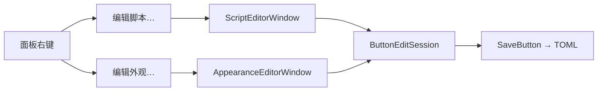

# 按钮编辑：外观 / 脚本 IDE 拆分方案

> **状态**：Phase 4 已完成（Native + egui 双入口对齐）  
> **日期**：2026-08-31  
> **取代**：[`BUTTON_EDITOR_SCRIPT_UNIFIED.md`](./BUTTON_EDITOR_SCRIPT_UNIFIED.md) §5 合一窗口布局  
> **关联**：[`ACTION_SCRIPT_PLAN.md`](./ACTION_SCRIPT_PLAN.md)、[`.cursor/plans/按钮编辑器脚本统一.plan.md`](../.cursor/plans/按钮编辑器脚本统一.plan.md)

---

## 1. 结论

| 项 | 决议 |
|----|------|
| 入口 | 面板右键 **「编辑脚本…」** / **「编辑外观…」**（「编辑…」= 编辑脚本别名） |
| 窗口 | **两个独立窗口**，同一 `ButtonConfig` draft，**互斥打开** |
| 外观窗 | 标签、图标、配色、可见范围、启用 |
| 脚本窗 | MeoFlow 源码 + 预设/工具（Phase 2 起 IDE 工具栏 + Phase 3 着色） |
| 数据 | 运行时 `ButtonEditSession` 共享 draft；各窗保存时 merge 字段 |

---

## 2. 架构



### 2.1 模块

| 文件 | 职责 |
|------|------|
| `button_edit_session.rs` | 共享 draft、attached_macro、legacy 标记 |
| `button_editor_common.rs` | 表单行、外观区、scope、footer 等 UI 辅助 |
| `appearance_editor.rs` | 外观编辑窗口 |
| `button_editor.rs` | 脚本编辑窗口 `ScriptEditorWindow` |
| `meoflow_highlight.rs` | MeoFlow 语法高亮（平台无关） |
| `script_editor_toolbar.rs` | 工具栏条（插入 / 模板 / 捕获 / 运行 / 帮助） |

---

## 3. 外观编辑窗口

**默认尺寸**：480 × 520（可缩放，min 440 × 420）

```
┌─ 编辑外观 · P0#3 ────────────────────────┐
│ 启用 [✓]    标签 [_______________]        │
│ 图标 [___] [选择] [清除]                  │
│ 外观：预览 + 快速配色 + 颜色 well         │
│ 可见范围 …                                │
├──────────────────────────────────────────┤
│                    [取消]  [保存]        │
└──────────────────────────────────────────┘
```

**保存**：更新 draft 的 label / icon / colors / scope / enabled；**不修改** `action`。

---

## 4. 脚本编辑窗口

**Phase 1**（已完成）：脚本区 + 预设/工具自合一窗迁移。

**Phase 2**（已完成）：

```
┌─ 编辑脚本 · P0#3 ─────────────────────────────────────────┐
│ [工具栏：插入▾ | 模板▾ | 捕获▾ | 运行 | 帮助]                │
├──────────────────────────────────────────────────────────────┤
│ MeoFlow 源码（等宽；Phase 3 着色 + 行号）                    │
├──────────────────────────────────────────────────────────────┤
│ Ln · Col │ 状态 │ 预览                                      │
├──────────────────────────────────────────────────────────────┤
│                                      [取消]  [保存]          │
└──────────────────────────────────────────────────────────────┘
```

工具栏为窗口内固定条（非 NSToolbar；objc2 双版本下 NSToolbarDelegate 返回类型暂不可用，后续可再升级）。

**Phase 3**（已完成）：左侧行号栏 + MeoFlow 语法着色 + 编译错误行浅红背景。

**保存**：`compile(source)` 通过后写入 `Action::Script`；外观字段取自 session draft 不变。

---

## 5. 右键菜单

```
编辑脚本…       ← EditScript（Edit=1 别名）
编辑外观…       ← EditAppearance
────────────────
启用 / 禁用 / 清空动作 / 删除
────────────────
设置… / 退出
```

---

## 6. Session 规则

1. 打开任一侧编辑窗时，若 profile+button 与当前 session 不同 → 关闭两窗、从配置新建 session  
2. 打开脚本窗 → 隐藏外观窗；打开外观窗 → 隐藏脚本窗  
3. 任一侧保存 → 更新 session.draft → `SaveButton` → 关闭该窗  
4. 取消 → 丢弃 session（若两窗皆关）  

---

## 7. 分阶段计划

| 阶段 | 内容 | 工期 |
|------|------|------|
| **Phase 1** | 右键两项 + 双窗 + session + 功能不退化 | ✅ |
| **Phase 2** | 工具栏条 + 状态栏 IDE 化 | ✅ |
| **Phase 3** | `meoflow_highlight.rs` 着色 + 行号 + 错误行 | ✅ |
| **Phase 4** | egui 双入口对齐 | ✅ |

---

## 8. Phase 1 完成定义

- [x] 右键「编辑脚本…」「编辑外观…」可用  
- [x] 两窗互斥；共享 draft 不丢数据  
- [x] 外观保存不影响脚本；脚本保存不影响外观  
- [x] legacy lazy upgrade、预设 wizard、捕获/录制、试运行正常  
- [x] `cargo test --features ui-native` 通过  

## 9. Phase 2 完成定义

- [x] 工具栏：插入 / 模板 / 捕获 / 运行 / 帮助  
- [x] 脚本区全高；预设与工具从文档区移出  
- [x] 状态栏：Ln · Col / 编译状态 / 步骤预览  
- [x] 功能不退化（预设 wizard、捕获、录制、试运行）  
- [x] `cargo test --features ui-native` 通过  

## 10. Phase 3 完成定义

- [x] `meoflow_highlight.rs`：Comment / Keyword / String / Number 着色  
- [x] 左侧行号栏 + 与脚本区滚动同步  
- [x] 编译错误行浅红背景  
- [x] `cargo test --features ui-native` 通过  

## 11. Phase 4 完成定义

- [x] egui 右键「编辑脚本…」「编辑外观…」  
- [x] 两个独立 viewport（脚本 / 外观），互斥打开  
- [x] 共享 `ButtonContextEditor` draft；换按钮重载、同按钮切换 surface 保留 draft  
- [x] 脚本窗仅动作编辑；外观窗仅标签/图标/配色/scope  
- [x] `cargo check --features ui-egui` 通过  

---

*文档版本：1.0 · 2026-08-31*
