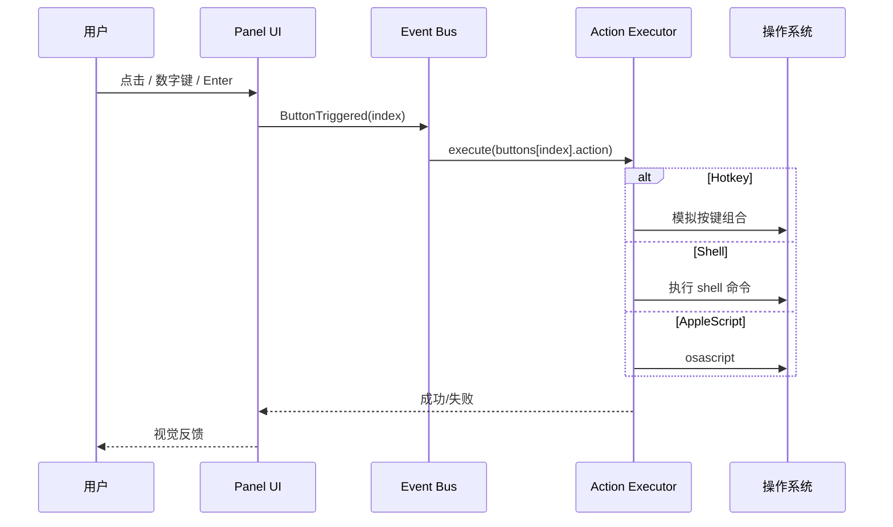
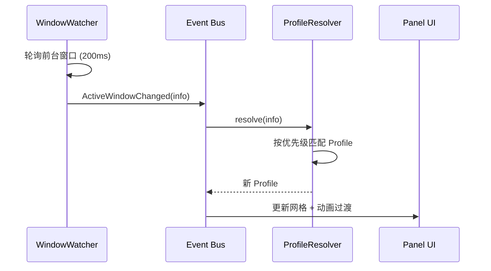

# MeoTool 设计文档

> 窗口关联的自定义快捷键浮动面板工具  
> 版本：v0.1（设计稿）  
> 更新日期：2026-06-26

---

## 目录

1. [项目概述](#1-项目概述)
2. [设计目标与约束](#2-设计目标与约束)
3. [功能需求](#3-功能需求)
4. [技术架构](#4-技术架构)
5. [数据模型与配置](#5-数据模型与配置)
6. [UI 设计](#6-ui-设计)
7. [交互设计](#7-交互设计)
8. [窗口关联机制](#8-窗口关联机制)
9. [动作执行](#9-动作执行)
10. [平台与权限](#10-平台与权限)
11. [性能与内存](#11-性能与内存)
12. [项目结构](#12-项目结构)
13. [分阶段实现计划](#13-分阶段实现计划)
14. [风险与待定事项](#14-风险与待定事项)

---

## 1. 项目概述

### 1.1 产品定位

MeoTool 是一款**常驻内存**的桌面快捷操作工具。它在屏幕上显示一个可配置的浮动按钮网格，用户可通过点击、数字键或方向键快速触发预设动作（快捷键、脚本、打开链接等）。

核心差异化能力：**根据当前激活的应用窗口，自动切换显示对应的快捷键配置**。

### 1.2 典型使用场景

| 场景 | 描述 |
|------|------|
| 代码编辑 | 切换到 VS Code 时，面板显示保存、格式化、运行、Git 等快捷按钮 |
| 设计工具 | 切换到 Figma/Sketch 时，面板显示对齐、导出、组件库等操作 |
| 通用办公 | 无匹配应用时，显示复制、粘贴、截图、锁屏等通用快捷键 |
| 折叠模式 | 工作时面板收成一个小图标，鼠标悬停时展开完整网格，减少屏幕占用 |

### 1.3 用户画像

- 需要高频使用快捷键、但记不住复杂组合键的 Power User
- 不同应用有不同工作流，希望「上下文感知」的快捷面板
- 对系统资源敏感，不希望后台工具占用大量内存

---

## 2. 设计目标与约束

### 2.1 设计目标

| 目标 | 指标/说明 |
|------|-----------|
| 低内存占用 | 常驻内存目标 15–40 MB（Release 构建） |
| 低延迟响应 | 按钮触发到动作执行 < 50 ms |
| 窗口切换感知 | 前台应用变化后，面板内容更新 < 300 ms |
| 高可配置性 | 网格尺寸、显示模式、透明度、按钮动作均可配置 |
| 无干扰 | 支持透明、置顶、可选点击穿透；折叠模式最小化视觉占用 |

### 2.2 设计约束

- **首选语言**：Rust（内存安全、无 GC、适合常驻进程）
- **首发平台**：macOS（darwin）
- **不使用**：Electron / Tauri WebView（避免 Chromium 常驻内存开销）
- **权限依赖**：需要辅助功能权限（窗口感知 + 按键模拟）和输入监控权限（全局热键）

### 2.3 非目标（v1 不做）

- 跨平台 Windows/Linux 支持（架构预留，v1 仅实现 macOS）
- 云同步配置、多设备协同
- 插件/脚本市场
- 复杂的条件分支 / 图像 RPA（完整桌面自动化）

> 轻量「鼠标宏」（单击捕获、短序列 + 关键点简化）见独立方案：[MOUSE_MACRO.md](./MOUSE_MACRO.md)。

---

## 3. 功能需求

### 3.1 功能总览

```
┌─────────────────────────────────────────────────────────┐
│                      MeoTool                         │
├─────────────┬─────────────┬─────────────┬───────────────┤
│  浮动面板   │  窗口关联   │  动作触发   │   配置管理    │
│  N×M 网格   │  Profile    │  点击       │   TOML 文件   │
│  5 种模式   │  自动切换   │  数字键     │   热加载      │
│  透明度     │  匹配规则   │  方向键     │   设置界面    │
└─────────────┴─────────────┴─────────────┴───────────────┘
```

### 3.2 功能清单

| ID | 功能 | 优先级 | 说明 |
|----|------|--------|------|
| F-01 | 可配置网格 | P0 | 行数、列数可定义，默认 3×3 |
| F-02 | 显示模式：文本 | P0 | 每个按钮显示名称 |
| F-03 | 显示模式：图标 | P0 | 每个按钮仅显示图标 |
| F-04 | 显示模式：序号+图标 | P0 | 左上角序号 + 中央图标 |
| F-05 | 显示模式：折叠 | P1 | 默认显示总图标，悬停展开全部按钮 |
| F-06 | 透明度 | P0 | 面板整体透明度 0.0–1.0 可配置 |
| F-07 | 窗口关联 | P0 | 根据前台应用自动切换 Profile |
| F-08 | 自定义按钮 | P0 | 每个按钮可配置标签、图标、动作 |
| F-09 | 点击触发 | P0 | 鼠标点击按钮执行动作 |
| F-10 | 数字键触发 | P0 | 按 1–9（或更多）对应按钮序号 |
| F-11 | 方向键导航 | P1 | ↑↓←→ 移动选中，Enter 确认触发 |
| F-12 | 全局热键 | P0 | 唤起/隐藏面板、重载配置 |
| F-13 | 配置热加载 | P1 | 修改配置文件后自动生效 |
| F-14 | 设置界面 | P2 | 图形化编辑配置（v1 可仅 TOML） |

---

## 4. 技术架构

### 4.1 架构总览

```
                    ┌──────────────────┐
                    │    main.rs       │
                    │  启动 / 权限检查  │
                    └────────┬─────────┘
                             │
              ┌──────────────┼──────────────┐
              ▼              ▼              ▼
     ┌────────────┐  ┌────────────┐  ┌────────────┐
     │ Window     │  │ Input      │  │ Config     │
     │ Watcher    │  │ Listener   │  │ Store      │
     │ (线程)     │  │ (线程)     │  │            │
     └─────┬──────┘  └─────┬──────┘  └─────┬──────┘
           │               │               │
           └───────────────┼───────────────┘
                           ▼
                  ┌─────────────────┐
                  │   Event Bus     │
                  │   (mpsc)        │
                  └────────┬────────┘
                           ▼
                  ┌─────────────────┐
                  │   AppState      │
                  │   状态机        │
                  └────────┬────────┘
                           │
              ┌────────────┼────────────┐
              ▼            ▼            ▼
     ┌────────────┐ ┌────────────┐ ┌────────────┐
     │ UI Panel   │ │ Action     │ │ Profile    │
     │ (egui)     │ │ Executor   │ │ Resolver   │
     └────────────┘ └────────────┘ └────────────┘
```

### 4.2 技术选型

| 层级 | 选型 | 版本建议 | 用途 |
|------|------|----------|------|
| 语言 | Rust | edition 2021 | 主语言 |
| 窗口 | winit | 0.29+ | 原生窗口、事件循环 |
| UI | egui + eframe | 0.27+ | 即时模式 UI、透明窗口 |
| 窗口感知 | active-win-pos-rs | latest | 获取前台窗口信息 |
| 全局热键 | global-hotkey | latest | 注册系统级快捷键 |
| 按键模拟 | enigo | latest | 发送键盘/鼠标事件 |
| 配置 | serde + toml | latest | 序列化与配置文件 |
| 异步 | tokio 或 std::thread | — | 后台轮询（轻量使用） |
| 文件监听 | notify | latest | 配置热加载（P1） |

### 4.3 进程模型

**单进程、多线程**：

| 线程 | 职责 | 通信方式 |
|------|------|----------|
| 主线程 | egui 渲染、本地输入（点击） | 接收 Event Bus 事件 |
| WindowWatcher 线程 | 每 200ms 轮询前台窗口 | 发送 `ActiveWindowChanged` |
| InputListener 线程 | 全局热键、数字键（面板可见时） | 发送 `ButtonTriggered` 等 |
| （可选）ConfigWatcher 线程 | 监听配置文件变更 | 发送 `ConfigReloaded` |

事件统一通过 `mpsc::channel` 汇聚到主循环，避免共享可变状态。

### 4.4 核心事件定义

```rust
enum AppEvent {
  /// 前台窗口变化
  ActiveWindowChanged(WindowInfo),
  /// 用户触发某个按钮（索引从 0 开始）
  ButtonTriggered(usize),
  /// 方向键导航
  Navigate(Direction),       // Up | Down | Left | Right
  /// 确认当前选中按钮
  ConfirmSelection,
  /// 切换面板可见性
  ToggleVisibility,
  /// 重新加载配置
  ConfigReloaded,
  /// 退出应用
  Quit,
}
```

---

## 5. 数据模型与配置

### 5.1 核心数据结构

```rust
/// 应用全局状态
struct AppState {
  visible: bool,
  current_profile: Profile,
  selected_cell: Option<(u8, u8)>,  // 方向键导航时的选中格
  opacity: f32,
  display_mode: DisplayMode,
}

/// 显示模式
enum DisplayMode {
  Text,        // 仅文本
  Icon,        // 仅图标
  IndexIcon,   // 序号 + 图标
  Collapsed,   // 折叠：总图标 + 悬停展开
}

/// 窗口匹配规则
struct MatchRule {
  bundle_id: Option<String>,     // 如 com.microsoft.VSCode
  app_name: Option<String>,      // 如 "Code"
  title_regex: Option<String>,   // 窗口标题正则
}

/// 一个 Profile = 一套面板配置
struct Profile {
  name: String,
  match_rule: Option<MatchRule>,  // None 表示 default
  panel: PanelConfig,
}

/// 面板布局配置
struct PanelConfig {
  rows: u8,
  cols: u8,
  display_mode: DisplayMode,
  opacity: f32,
  button_size: u32,              // 像素，默认 64
  gap: u32,                      // 按钮间距，默认 4
  position: Position,            // 屏幕坐标
  collapsed_icon: Option<String>,// 折叠模式的总图标
  buttons: Vec<ButtonConfig>,
}

/// 单个按钮
struct ButtonConfig {
  label: String,
  icon: Option<String>,          // 相对 assets/icons/ 的路径
  action: Action,
  enabled: bool,
}

/// 可执行动作
enum Action {
  Hotkey(Vec<Key>),              // ["Cmd", "Shift", "P"]
  Shell { command: String },
  AppleScript { script: String },
  OpenUrl { url: String },
  OpenFile { path: String },
  None,                          // 占位空按钮
}
```

### 5.2 配置文件示例

路径：`~/.config/meotool/config.toml`（macOS 也可用 `~/Library/Application Support/meotool/config.toml`）

```toml
# ─── 全局设置 ───────────────────────────────────────────

[global]
toggle_visibility = "Cmd+Shift+P"   # 显示/隐藏面板
reload_config     = "Cmd+Shift+R"   # 重载配置
quit              = "Cmd+Shift+Q"   # 退出（仅在面板聚焦时）

[global.panel]
rows          = 3
cols          = 3
display_mode  = "text"              # text | icon | index_icon | collapsed
opacity       = 0.85
button_size   = 64
gap           = 4
position      = { x = 100, y = 200 }

# ─── 默认 Profile（无窗口匹配时使用）────────────────────

[[profiles]]
name = "default"

  [[profiles.buttons]]
  label = "复制"
  icon  = "copy.png"
  action = { type = "hotkey", keys = ["Cmd", "C"] }

  [[profiles.buttons]]
  label = "粘贴"
  icon  = "paste.png"
  action = { type = "hotkey", keys = ["Cmd", "V"] }

  [[profiles.buttons]]
  label = "截图"
  icon  = "screenshot.png"
  action = { type = "hotkey", keys = ["Cmd", "Shift", "4"] }

  [[profiles.buttons]]
  label = "文档"
  action = { type = "open_file", path = "~/Documents" }

# ─── VS Code Profile ──────────────────────────────────

[[profiles]]
name = "vscode"

  [profiles.match]
  bundle_id = "com.microsoft.VSCode"

  [profiles.panel]
  rows = 2
  cols = 4
  display_mode = "index_icon"

  [[profiles.buttons]]
  label = "保存"
  icon  = "save.png"
  action = { type = "hotkey", keys = ["Cmd", "S"] }

  [[profiles.buttons]]
  label = "格式化"
  icon  = "format.png"
  action = { type = "hotkey", keys = ["Shift", "Option", "F"] }

  [[profiles.buttons]]
  label = "命令面板"
  icon  = "command.png"
  action = { type = "hotkey", keys = ["Cmd", "Shift", "P"] }

  [[profiles.buttons]]
  label = "终端"
  icon  = "terminal.png"
  action = { type = "hotkey", keys = ["Ctrl", "`"] }

# ─── 浏览器 Profile（标题正则匹配）────────────────────

[[profiles]]
name = "browser"

  [profiles.match]
  title_regex = ".*- (Google Chrome|Safari|Firefox)$"

  [[profiles.buttons]]
  label = "新标签"
  icon  = "new_tab.png"
  action = { type = "hotkey", keys = ["Cmd", "T"] }

  [[profiles.buttons]]
  label = "关闭标签"
  icon  = "close_tab.png"
  action = { type = "hotkey", keys = ["Cmd", "W"] }
```

### 5.3 Profile 匹配优先级

```
1. bundle_id 精确匹配
2. title_regex 正则匹配
3. app_name 精确匹配（忽略大小写）
4. 回退到 name = "default" 的 Profile
```

多个规则同时命中时，按配置文件中的顺序，**先定义的优先**。

---

## 6. UI 设计

### 6.1 设计原则

- **极简**：面板本身是工具，不应喧宾夺主
- **一致**：所有显示模式共享同一套网格逻辑，仅渲染层不同
- **可读**：透明背景下，按钮需有足够对比度（背景色 + 描边）
- **紧凑**：默认尺寸适合笔记本屏幕，可通过配置放大

### 6.2 窗口属性

| 属性 | 值 | 说明 |
|------|-----|------|
| 装饰 | 无边框 | `decorations = false` |
| 置顶 | 是 | `always_on_top = true` |
| 透明 | 是 | 窗口背景透明，面板区域 Semi-transparent |
| 任务栏 | 不显示 | 避免占用 Dock（macOS 可作为 Accessory 应用） |
| 尺寸 | 动态计算 | `(cols × button_size + gaps, rows × button_size + gaps)` |
| 位置 | 可配置 | 默认屏幕左上角偏移 (100, 200)，支持拖拽记忆 |

### 6.3 视觉规范

#### 色彩（深色主题，默认）

| 元素 | 色值 | 说明 |
|------|------|------|
| 按钮背景 | `rgba(40, 40, 40, 0.85)` | 半透明深灰 |
| 按钮悬停 | `rgba(60, 60, 60, 0.90)` | 略亮 |
| 按钮按下 | `rgba(80, 80, 80, 0.95)` | 反馈态 |
| 按钮描边 | `rgba(255, 255, 255, 0.15)` | 1px 细描边 |
| 文字 | `#E0E0E0` | 主文字 |
| 序号角标 | `#FFFFFF` on `rgba(0,0,0,0.6)` | 左上角圆角矩形 |
| 选中高亮 | `rgba(0, 122, 255, 0.6)` | 方向键导航时外框 |

#### 尺寸

| 元素 | 默认值 | 范围 |
|------|--------|------|
| 按钮边长 | 64 px | 48–96 px |
| 按钮间距 | 4 px | 2–8 px |
| 图标尺寸 | 32 px | 24–48 px |
| 文字大小 | 11 px | 9–14 px |
| 序号角标 | 16 × 16 px | — |
| 圆角 | 8 px | — |

#### 字体

- 系统默认无衬线字体（macOS: SF Pro Text）
- 文字模式：标签居中，超出截断为 `...`

### 6.4 显示模式详解

#### 模式 1：文本（Text）

```
┌────────┐ ┌────────┐ ┌────────┐
│  复制  │ │  粘贴  │ │  截图  │
└────────┘ └────────┘ └────────┘
┌────────┐ ┌────────┐ ┌────────┐
│  保存  │ │  撤销  │ │  重做  │
└────────┘ └────────┘ └────────┘
┌────────┐ ┌────────┐ ┌────────┐
│        │ │        │ │        │
└────────┘ └────────┘ └────────┘
```

- 每个格子显示 `label` 文字
- 无图标时仍可正常使用
- 适合按钮少、名称直观的场景

#### 模式 2：图标（Icon）

```
┌────────┐ ┌────────┐ ┌────────┐
│  📋    │ │  📌    │ │  📷    │
└────────┘ └────────┘ └────────┘
```

- 仅显示图标，居中
- 无图标时显示 `label` 首字作为 fallback
- Tooltip：悬停 300ms 后显示完整 `label`

#### 模式 3：序号 + 图标（IndexIcon）

```
┌────────┐ ┌────────┐ ┌────────┐
│①      │ │②      │ │③      │
│  📋    │ │  📌    │ │  📷    │
└────────┘ └────────┘ └────────┘
```

- 左上角显示序号（1–9，超过 9 显示 10+）
- 中央显示图标
- 序号与数字键触发一一对应，降低学习成本
- 推荐作为默认模式

#### 模式 4：折叠（Collapsed）

**收起态：**

```
    ┌────┐
    │ ⚡ │  ← 总图标（可配置，默认闪电）
    └────┘
```

**悬停展开态：**

```
              ┌────────┐ ┌────────┐ ┌────────┐
              │① 📋   │ │② 📌   │ │③ 📷   │
              └────────┘ └────────┘ └────────┘
┌────┐        ┌────────┐ ┌────────┐ ┌────────┐
│ ⚡ │───────→│④      │ │⑤      │ │⑥      │
└────┘        └────────┘ └────────┘ └────────┘
```

- 默认只显示一个圆形总图标（直径 40px）
- 鼠标移入后，网格从总图标位置**向左上或右上展开**（根据屏幕边缘自动选择方向）
- 展开动画：150ms ease-out 缩放 + 淡入
- 鼠标移出整个面板区域 500ms 后自动收起
- 展开时总图标保持可见，作为锚点

#### 模式 5：透明度

- `opacity` 作用于整个面板容器（0.0 = 完全透明，1.0 = 不透明）
- 建议范围：0.7–0.95，过低影响可读性
- 按钮背景 alpha 独立于面板 opacity 叠加计算

### 6.5 空槽与禁用态

| 状态 | 视觉 |
|------|------|
| 空槽（无配置） | 虚线边框，无内容，不可点击 |
| 禁用（`enabled = false`） | 透明度 40%，不可点击 |
| 加载中 | 按钮中央显示小型 spinner（仅首次加载图标时） |

### 6.6 面板布局示意（3×3，IndexIcon 模式）

```
╔═══════════════════════════════════════════╗
║  MeoTool                     [─] [×]  ║  ← v2 可选标题栏，v1 无
╠═══════════════════════════════════════════╣
║                                           ║
║   ┌──────────┐ ┌──────────┐ ┌──────────┐  ║
║   │ ①        │ │ ②        │ │ ③        │  ║
║   │   📋     │ │   📌     │ │   📷     │  ║
║   │  复制    │ │  粘贴    │ │  截图    │  ║  ← 可选副标签
║   └──────────┘ └──────────┘ └──────────┘  ║
║                                           ║
║   ┌──────────┐ ┌──────────┐ ┌──────────┐  ║
║   │ ④        │ │ ⑤        │ │ ⑥        │  ║
║   │   💾     │ │   ↩️     │ │   ↪️     │  ║
║   └──────────┘ └──────────┘ └──────────┘  ║
║                                           ║
║   ┌──────────┐ ┌──────────┐ ┌──────────┐  ║
║   │ ⑦        │ │ ⑧        │ │ ⑨        │  ║
║   │   🔍     │ │   ⚙️     │ │          │  ║
║   └──────────┘ └──────────┘ └──────────┘  ║
║                                           ║
╚═══════════════════════════════════════════╝

总尺寸（默认）：(3×64 + 2×4) × (3×64 + 2×4) = 200 × 200 px
```

### 6.7 窗口切换时的过渡

- Profile 切换时，面板内容**交叉淡入淡出**（100ms）
- 若新 Profile 网格尺寸不同，面板窗口尺寸同步动画调整（150ms）
- 切换时在面板右上角短暂显示应用名（1.5s 后消失）：

```
┌─────────────────────────┐
│                  VS Code │  ← 临时提示，右上角
│  ...按钮网格...          │
└─────────────────────────┘
```

---

## 7. 交互设计

### 7.1 交互方式总览

| 输入方式 | 前置条件 | 行为 |
|----------|----------|------|
| 鼠标点击 | 面板可见 | 点击按钮 → 立即触发动作 |
| 鼠标悬停 | 任意模式 | 显示 Tooltip（Icon 模式必须） |
| 数字键 1–9 | 面板可见 + 导航模式开启 | 按下数字键 → 触发对应序号按钮 |
| 方向键 | 面板可见 + 导航模式开启 | 移动选中高亮 |
| Enter | 已有选中格 | 触发选中按钮 |
| Escape | 面板可见 | 取消选中 / 折叠模式收起 |
| 全局热键 | 任意 | 见 7.5 |
| 拖拽 | 面板可见 | 拖动面板位置（位置自动保存） |

### 7.2 鼠标交互

#### 点击

1. 用户点击按钮
2. 按钮进入按下态（50ms）
3. 触发 `ButtonTriggered(index)`
4. `ActionExecutor` 执行动作
5. 按钮恢复默认态

#### 悬停

- 所有模式：光标变为 `pointer`
- Icon / IndexIcon 模式：300ms 后显示 Tooltip
- Collapsed 模式：移入总图标 → 展开网格；移出整个区域 500ms → 收起

#### 拖拽

- 在按钮间隙或面板边距区域按住可拖动整个面板
- 拖动时面板半透明降至 0.7
- 释放后保存 `position` 到配置文件

### 7.3 键盘交互

#### 数字键触发

```
面板可见时：
  键 "1" → buttons[0]
  键 "2" → buttons[1]
  ...
  键 "9" → buttons[8]
```

- 仅在面板**可见**且**未聚焦其他输入框**时生效
- 通过 `CGEventTap` 或面板窗口聚焦时监听 `ReceivedCharacter`
- v1 推荐：面板窗口保持聚焦（`focusable = true`），失去焦点时仅点击可用

#### 方向键导航

```
初始：无选中
按 ↑↓←→：选中移动到相邻格（循环不越界）
按 Enter：触发当前选中格按钮
按 Escape：清除选中
```

选中态视觉：蓝色外框 + 轻微放大（scale 1.05）

导航映射（3×3 示例）：

```
┌───┬───┬───┐
│ 0 │ 1 │ 2 │
├───┼───┼───┤
│ 3 │ 4 │ 5 │
├───┼───┼───┤
│ 6 │ 7 │ 8 │
└───┴───┴───┘
```

### 7.4 反馈与状态

| 事件 | 反馈 |
|------|------|
| 动作执行成功 | 按钮短暂闪绿（100ms） |
| 动作执行失败 | 按钮短暂闪红（200ms）+ 日志 |
| Profile 切换 | 内容交叉淡入 + 应用名提示 |
| 配置重载 | 面板中央 Toast「配置已重载」（1s） |
| 权限缺失 | 启动时弹窗引导开启辅助功能 |

### 7.5 全局热键

| 热键（默认） | 功能 |
|--------------|------|
| `Cmd+Shift+P` | 切换面板显示/隐藏 |
| `Cmd+Shift+R` | 重新加载配置文件 |
| `Cmd+Shift+Q` | 退出 MeoTool（需二次确认或仅在面板可见时） |

- 全局热键通过 `global-hotkey` 注册，应用启动时生效
- 可在 `config.toml` 的 `[global]` 段自定义

### 7.6 启动与退出

#### 启动流程

```
1. 解析命令行参数（--config 路径）
2. 检查 macOS 辅助功能权限
   └─ 未授权 → 显示引导对话框 → 等待用户授权 → 重试
3. 加载 config.toml
4. 预加载图标资源
5. 创建透明置顶窗口
6. 启动 WindowWatcher 线程
7. 注册全局热键
8. 进入 egui 事件循环
```

#### 退出流程

```
1. 用户触发 Quit 热键或菜单
2. 保存当前 position 到配置
3. 注销全局热键
4. 关闭窗口
5. 进程退出
```

### 7.7 交互流程图

#### 按钮触发流程



#### 窗口关联切换流程



---

## 8. 窗口关联机制

### 8.1 窗口信息采集

通过 `active-win-pos-rs` 获取：

```rust
struct WindowInfo {
  app_name: String,       // "Code"
  bundle_id: String,    // "com.microsoft.VSCode"
  title: String,          // "main.rs — project"
  pid: u32,
}
```

### 8.2 轮询策略

- 间隔：200ms（可配置 `window_poll_interval_ms`）
- 仅当 `bundle_id` 或 `title` 变化时分发事件
- 避免重复切换同一 Profile

### 8.3 匹配算法

```rust
fn resolve_profile<'a>(profiles: &'a [Profile], window: &WindowInfo) -> &'a Profile {
  for profile in profiles {
    if let Some(rule) = &profile.match_rule {
      if rule.bundle_id.as_deref() == Some(&window.bundle_id) {
        return profile;
      }
      if let Some(re) = &rule.title_regex {
        if Regex::new(re).unwrap().is_match(&window.title) {
          return profile;
        }
      }
      if rule.app_name.as_deref().map(|n| n.eq_ignore_ascii_case(&window.app_name)) == Some(true) {
        return profile;
      }
    }
  }
  profiles.iter().find(|p| p.name == "default").unwrap()
}
```

### 8.4 Profile 切换时的行为

| 属性 | 是否继承自 global | 说明 |
|------|-------------------|------|
| position | 是 | 面板位置全局统一，不随 Profile 变 |
| opacity | 可被 Profile 覆盖 | Profile.panel.opacity 优先 |
| rows/cols | Profile 独立 | 切换时动态调整窗口大小 |
| display_mode | Profile 独立 | 不同应用可有不同模式 |
| buttons | Profile 独立 | 完全替换 |

---

## 9. 动作执行

### 9.1 动作类型

| 类型 | 示例 | 实现 |
|------|------|------|
| Hotkey | `Cmd+Shift+P` | enigo 模拟按键序列 |
| OpenApp | `Terminal` / Bundle ID | `open` / `open -b` / `open -a` |
| Shell | `open -a Safari` | `std::process::Command` |
| OpenUrl | `https://example.com` | `open` 命令 |
| OpenFile | `~/Documents/report.pdf` | `open` 用系统默认应用打开本地文件或文件夹 |
| PasteText | 预设文本 | 剪贴板 + 模拟 Cmd+V |
| MouseMacro | 单击 / 短序列 | 窗口相对坐标回放（见 [MOUSE_MACRO.md](./MOUSE_MACRO.md)） |
| Script | 动作脚本（MeoFlow） | 行式 DSL → Flow IR → 顺序执行（见 [ACTION_SCRIPT_PLAN.md](./ACTION_SCRIPT_PLAN.md)） |
| None | — | 无操作 |

### 9.2 Hotkey 执行细节

1. 解析按键名到 KeyCode（支持 Cmd/Ctrl/Alt/Shift + 字母/数字/F键）
2. 依次按下修饰键 → 主键 → 释放（间隔 10ms）
3. 目标应用保持前台（不切换焦点）

### 9.3 错误处理

| 错误 | 处理 |
|------|------|
| 未知按键名 | 日志警告，跳过该动作 |
| 权限不足 | 提示用户开启辅助功能 |
| Shell 非零退出 | 日志错误，按钮闪红 |
| 动作执行超时（>3s） | 中止并日志 |

---

## 10. 平台与权限

### 10.1 macOS 权限

| 权限 | 用途 | 获取方式 |
|------|------|----------|
| 辅助功能 (Accessibility) | 窗口信息、按键模拟 | 系统设置 → 隐私与安全性 → 辅助功能 |
| 输入监控 (Input Monitoring) | 全局热键 | 系统设置 → 隐私与安全性 → 输入监控 |

启动时检测权限，未授权则显示引导：

```
┌─────────────────────────────────────────┐
│  MeoTool 需要辅助功能权限             │
│                                         │
│  用于：                                  │
│  • 检测当前活动窗口                      │
│  • 模拟键盘快捷键                        │
│                                         │
│  [打开系统设置]    [稍后]                │
└─────────────────────────────────────────┘
```

### 10.2 应用类型

- 建议注册为 **LSUIElement**（不在 Dock 显示图标）
- 通过全局热键或菜单栏图标（v2）唤起

### 10.3 配置路径

| 平台 | 配置目录 |
|------|----------|
| macOS | `~/Library/Application Support/meotool/` |
| 图标 | `~/Library/Application Support/meotool/icons/` |
| 日志 | `~/Library/Logs/meotool/meotool.log` |

---

## 11. 性能与内存

### 11.1 目标指标

| 指标 | 目标 |
|------|------|
| 常驻内存 (RSS) | < 40 MB |
| 二进制大小 | < 15 MB (stripped) |
| 启动时间 | < 500 ms |
| 按钮触发延迟 | < 50 ms |
| 窗口切换响应 | < 300 ms |
| CPU 空闲占用 | < 1% |

### 11.2 优化策略

- **图标**：启动时一次性解码为纹理，按钮尺寸 32–48px PNG
- **配置**：全量加载，Profile 切换只换引用
- **轮询**：200ms 间隔，非 60fps
- **构建**：Release 启用 `lto = true`, `strip = true`, `opt-level = "s"`
- **避免**：WebView、频繁堆分配、无界 channel

### 11.3 Cargo.toml Release 配置

```toml
[profile.release]
opt-level = "s"
lto = true
strip = true
codegen-units = 1
```

---

## 12. 项目结构

```
meotool/
├── Cargo.toml
├── README.md
├── docs/
│   └── DESIGN.md              # 本文档
├── assets/
│   └── icons/                 # 内置默认图标
│       ├── copy.png
│       ├── paste.png
│       └── ...
├── configs/
│   └── config.example.toml    # 示例配置
└── src/
    ├── main.rs                # 入口、权限检查
    ├── app/
    │   ├── mod.rs
    │   └── state.rs           # AppState 状态机
    ├── config/
    │   ├── mod.rs
    │   ├── model.rs           # 数据结构定义
    │   └── store.rs           # 加载/保存/热加载
    ├── window/
    │   ├── mod.rs
    │   └── watcher.rs         # 前台窗口轮询
    ├── ui/
    │   ├── mod.rs
    │   ├── panel.rs           # 窗口创建、透明、置顶
    │   ├── grid.rs            # N×M 网格布局
    │   ├── modes.rs           # 5 种显示模式渲染
    │   └── theme.rs           # 颜色、尺寸、字体
    ├── input/
    │   ├── mod.rs
    │   ├── keyboard.rs        # 数字键、方向键
    │   └── hotkey.rs          # 全局热键注册
    ├── action/
    │   ├── mod.rs
    │   └── executor.rs        # 动作执行器
    └── platform/
        ├── mod.rs
        └── macos.rs           # 权限检查、macOS 特有逻辑
```

---

## 13. 分阶段实现计划

### M1：最小可用原型（1–2 周）

- [x] 项目骨架、Cargo.toml
- [ ] 透明置顶无边框窗口（eframe）
- [ ] 固定 3×3 网格，Text 模式
- [ ] 点击按钮 → 模拟 Cmd+C
- [ ] 硬编码配置

**验收**：启动后显示 3×3 面板，点击按钮能触发系统快捷键。

### M2：配置化与显示模式（1–2 周）

- [ ] TOML 配置加载
- [ ] 可配置 rows/cols
- [ ] 实现 Text / Icon / IndexIcon 三种模式
- [ ] 透明度配置
- [ ] 图标加载与缓存

**验收**：修改 config.toml 可改变网格和显示效果，无需重新编译。

### M3：窗口关联（1 周）

- [ ] WindowWatcher 线程
- [ ] Profile 匹配与自动切换
- [ ] 切换动画 + 应用名提示
- [ ] 动态调整窗口尺寸

**验收**：切换到 VS Code 时面板自动显示 VS Code 专属按钮。

### M4：输入增强（1 周）

- [ ] 数字键 1–9 触发
- [ ] 方向键导航 + Enter 确认
- [ ] 全局热键（显示/隐藏、重载、退出）
- [ ] 面板拖拽与位置记忆

**验收**：无需鼠标，纯键盘可操作面板。

### M5：折叠模式与打磨（1 周）

- [ ] Collapsed 显示模式
- [ ] 悬停展开/收起动画
- [ ] 配置热加载（notify）
- [ ] 权限引导对话框
- [ ] 日志与错误反馈

**验收**：折叠模式可用，配置修改后自动生效。

### M6（可选）：设置界面

- [ ] 图形化配置编辑器
- [ ] 快捷键录制
- [ ] 菜单栏图标

---

## 14. 风险与待定事项

### 14.1 风险

| 风险 | 影响 | 缓解措施 |
|------|------|----------|
| macOS 权限获取困难 | 核心功能不可用 | 启动时明确引导，提供权限检测 API |
| 全局热键与其他应用冲突 | 热键不生效 | 配置可自定义，文档说明常见冲突 |
| 按键模拟被目标应用拒绝 | 部分快捷键无效 | 支持 AppleScript 作为替代 |
| egui 透明窗口在部分 macOS 版本异常 | UI 显示问题 | 测试多版本，准备 winit 裸奔备选 |
| 窗口匹配误命中 | 显示错误 Profile | 优先 bundle_id，提供调试日志 |

### 14.2 待定事项

| 事项 | 选项 | 建议 |
|------|------|------|
| 面板是否获取焦点 | 始终聚焦 vs 仅点击时聚焦 | v1 始终聚焦，保证数字键可用 |
| 多显示器支持 | 面板跟随窗口 vs 固定屏幕 | v1 固定主屏，v2 跟随 |
| 菜单栏图标 | 是否需要 | v2 加入 |
| 配置编辑器 | TOML 手写 vs GUI | v1 TOML，v2 GUI |
| 按钮超出 9 个时的数字键 | 支持 10+ 或使用组合键 | v1 仅 1–9，超出用点击/方向键 |

---

## 附录 A：按键名映射表

| 配置名 | macOS Key |
|--------|-----------|
| Cmd | Command (⌘) |
| Ctrl | Control |
| Alt / Option | Option (⌥) |
| Shift | Shift (⇧) |
| Enter | Return |
| Space | Space |
| Tab | Tab |
| Escape | Escape |
| Delete | Delete |
| Backspace | Backspace |
| F1–F12 | F1–F12 |
| A–Z | 对应字母 |
| 0–9 | 对应数字 |
| ` | Backtick |
| , . / ; ' [ ] \ - = | 对应符号键 |

## 附录 B：依赖清单（Cargo.toml 草案）

```toml
[package]
name = "meotool"
version = "0.1.0"
edition = "2021"

[dependencies]
eframe = "0.27"
egui = "0.27"
serde = { version = "1", features = ["derive"] }
toml = "0.8"
active-win-pos-rs = "0.8"
global-hotkey = "0.5"
enigo = "0.2"
regex = "1"
log = "0.4"
env_logger = "0.11"
notify = "6"          # M5
dirs = "5"            # 配置路径

[profile.release]
opt-level = "s"
lto = true
strip = true
codegen-units = 1
```

---

*文档结束*
